# ISM Search Workbench

Local-first search, comparison and natural-language analysis for the Australian Information Security Manual.

ISM Search Workbench is a portfolio-grade analyst surface for security practitioners who need to find ASD ISM controls,
compare releases, generate draft governance artefacts and keep current ACSC advisory context close to the control review
workflow.

**Public ISM Explorer:** <https://jusso-dev.github.io/ISMSearch/> is a static, nightly-refreshed GitHub Pages build of the latest
ISM, its release history and the ACSC alerts and advisories archive. It needs no server. The full workbench described below
runs locally with Docker.

## Screenshots

The full screenshot set is collapsed so the project overview stays easy to scan.

<details>
<summary><strong>Desktop workbench gallery</strong></summary>

| Search and filters | Natural-language evidence |
| --- | --- |
| 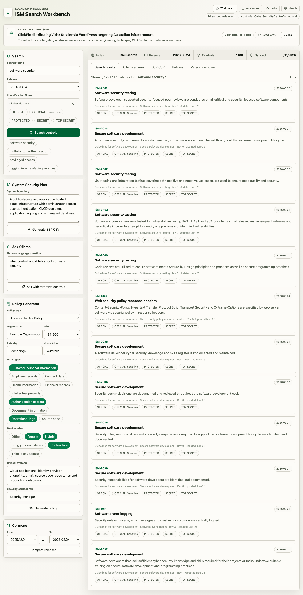 | 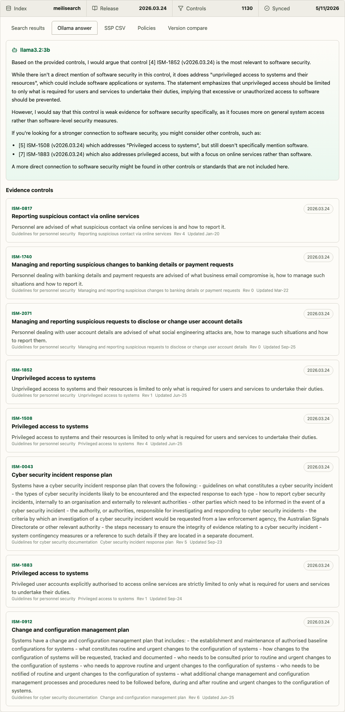 |
| 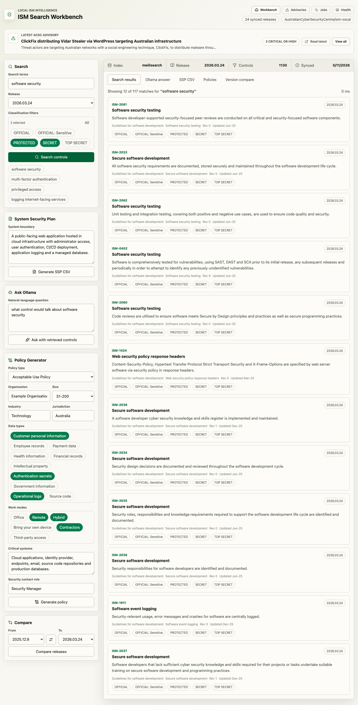 | 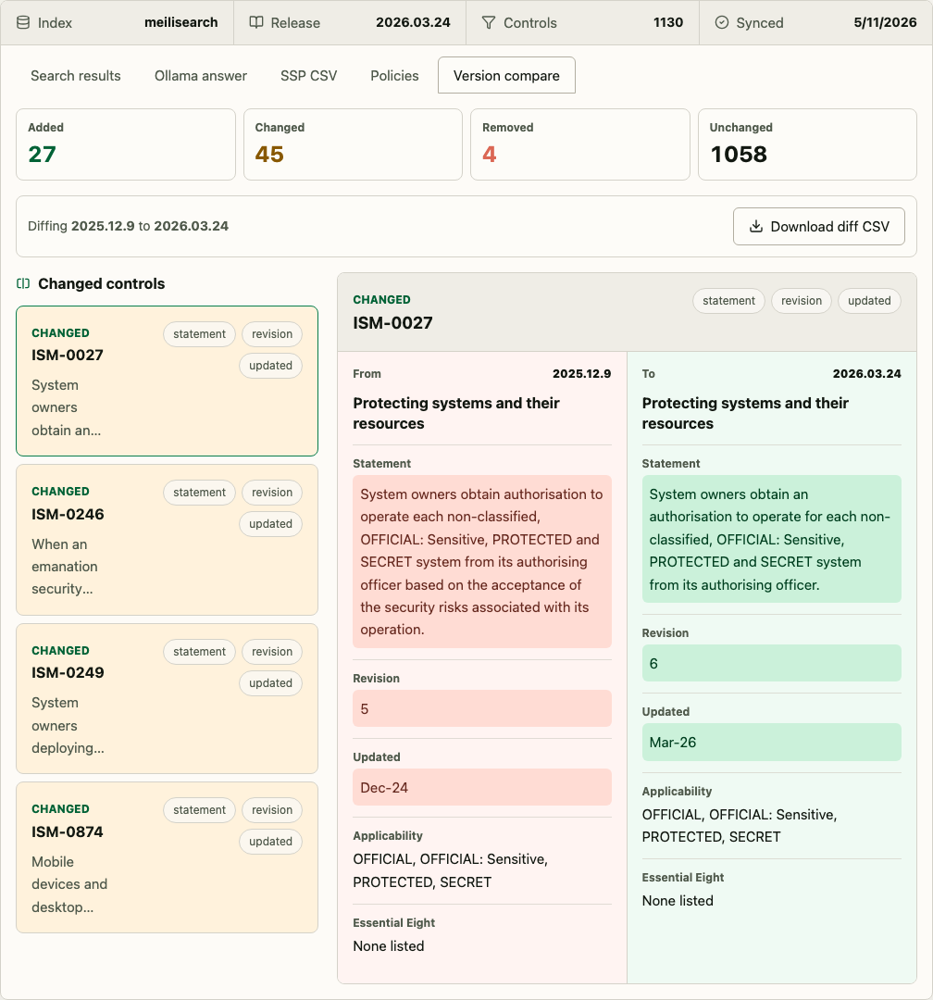 |

| Governance generation | Policy drafting |
| --- | --- |
| 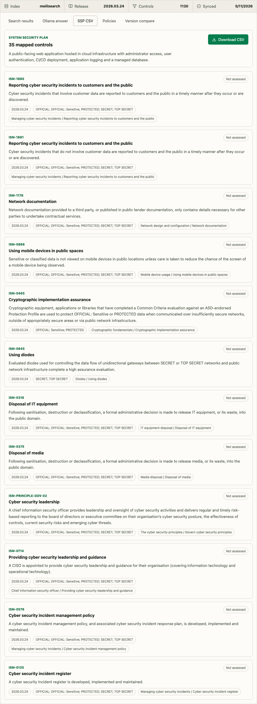 | 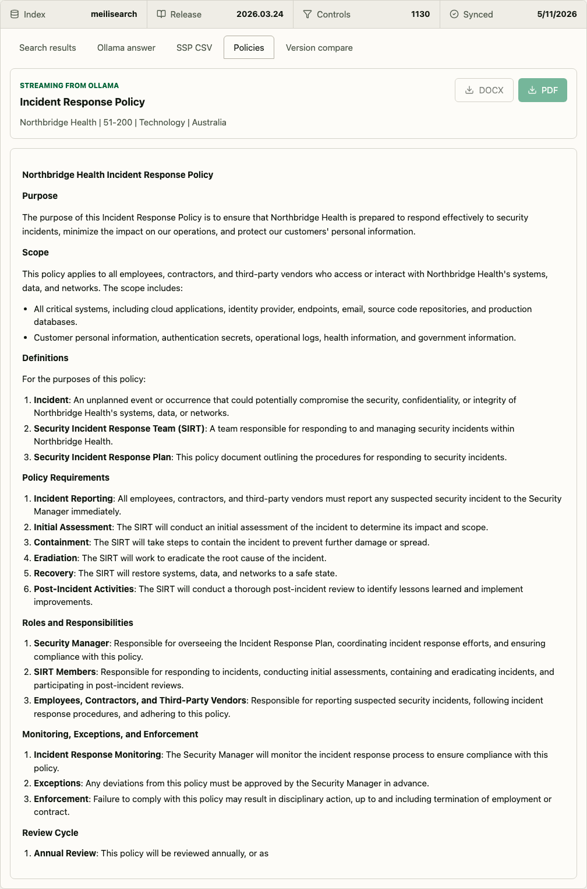 |

</details>

<details>
<summary><strong>Intelligence and operations gallery</strong></summary>

| ACSC advisories | Jobs | Health |
| --- | --- | --- |
| 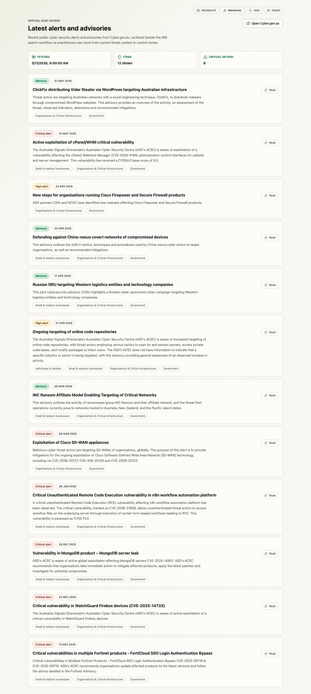 | 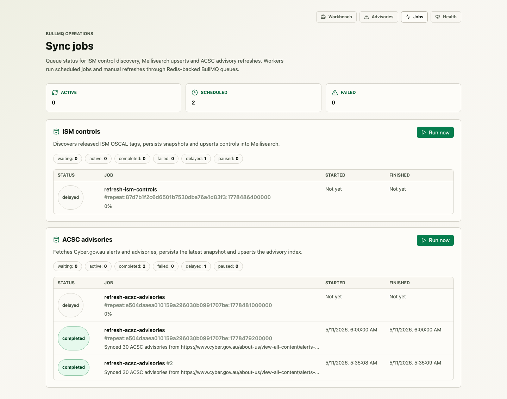 | 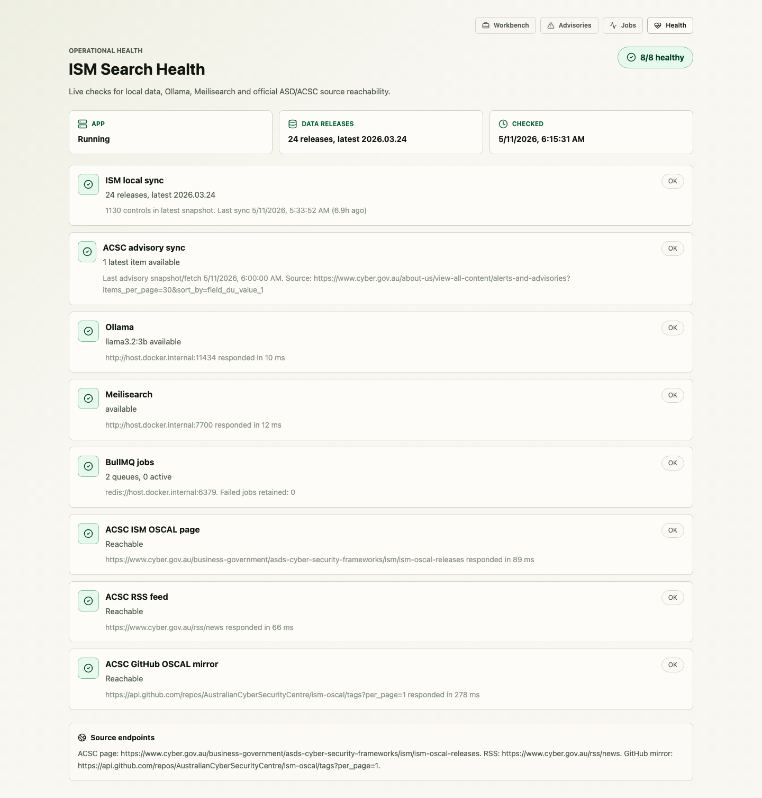 |

</details>

<details>
<summary><strong>Mobile gallery</strong></summary>

| Workbench | Results | Advisories |
| --- | --- | --- |
| 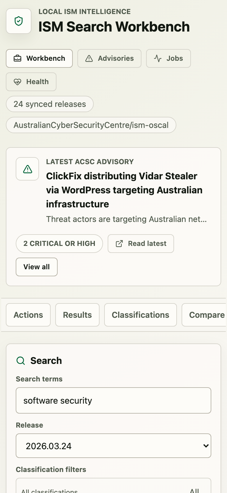 | 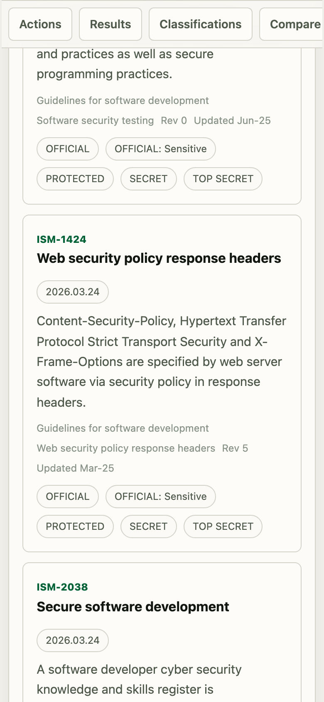 | 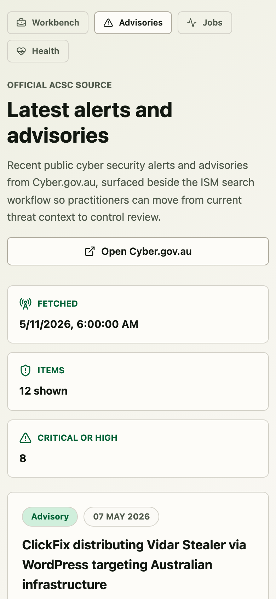 |

| Jobs | Health |
| --- | --- |
| 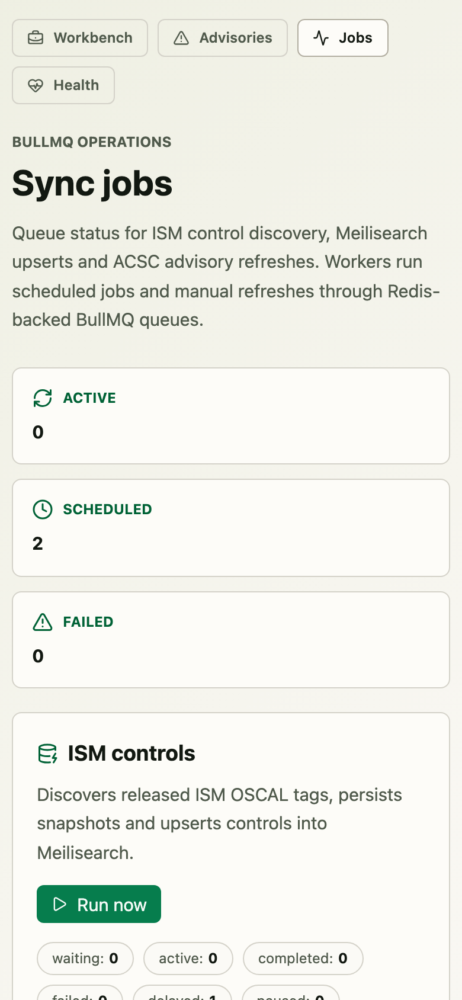 | 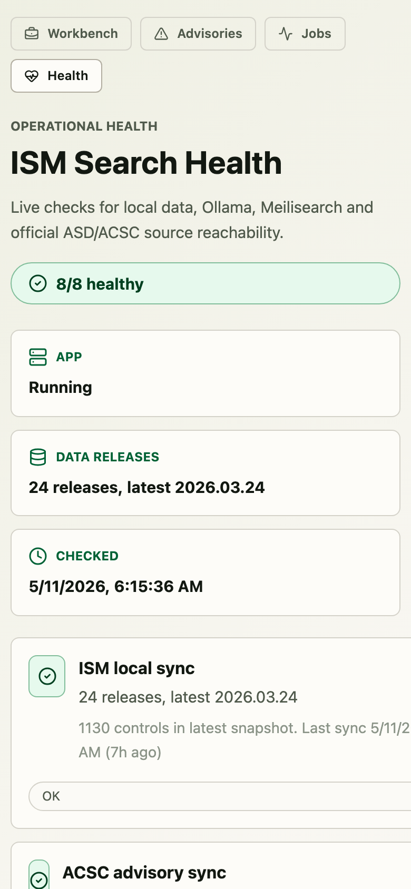 |

</details>

## What It Does

- Searches all synced ISM OSCAL releases with Meilisearch, falling back to local JSON snapshots when Meilisearch is missing or not yet indexed.
- Filters controls by classification (OFFICIAL, OFFICIAL: Sensitive, PROTECTED, SECRET, TOP SECRET), chapter and Essential Eight maturity level, with paging and CSV export of matching controls.
- Keeps the workbench state (query, release, filters, tab and comparison) in the URL so views can be shared.
- Gives every control a permalink at `/controls/ISM-1234` with its full history: when it was introduced, revised, moved or removed across every release, with word-level statement diffs and links to the official OSCAL source.
- Compares any two releases with added, removed, changed and unchanged counts. A change to the statement, title, chapter, section, topic, revision, update date, applicability or Essential Eight level counts as changed. Results show side by side and download as CSV.
- Generates SSP-style CSVs either from controls relevant to a system boundary description or from the full baseline that matches the filters.
- Streams Ollama answers grounded in retrieved controls, with evidence controls, cancellation and clear error states.
- Generates policy drafts with Ollama for common organisational policies, then downloads them as DOCX or PDF.
- Archives ACSC alerts and advisories from the official Cyber.gov.au RSS feeds and shows them on the homepage and `/advisories`, filterable by type and severity.
- Runs BullMQ jobs for ISM and ACSC sync work, backed by Redis.
- Shows operational status for data freshness, Ollama, Meilisearch, BullMQ, ACSC feeds and the GitHub OSCAL mirror.

## Routes

| Route | Purpose |
| --- | --- |
| `/` | Main ISM workbench for search, Ollama questions, SSP CSV, policy generation and version diffing. |
| `/controls/[id]` | Control permalink with release history (`/controls/1234` and `/controls/ism-1234` redirect to `/controls/ISM-1234`). |
| `/advisories` | ACSC alerts and advisories archive with type and severity filters. |
| `/jobs` | BullMQ queue dashboard with manual refresh buttons for ISM controls and ACSC advisories. |
| `/health` | Live health checks for local data, ACSC sync, Ollama, Meilisearch, BullMQ and official endpoints. |
| `/api/search` | Control search API (`q`, `version`, `limit`, `offset`, `applicability`, `chapter`, `essentialEight`). |
| `/api/facets` | Chapters and Essential Eight levels for a release. |
| `/api/controls/[id]` | Control history API. |
| `/api/ask` | Streaming (NDJSON) Ollama question-answer API. |
| `/api/ssp` | SSP CSV row generation API (`mode`: `search` or `baseline`). |
| `/api/policy` | Streaming (NDJSON) policy generation API. |
| `/api/compare` | ISM version diff API. |
| `/api/jobs` | BullMQ status and enqueue API. |
| `/api/versions` | Synced ISM release manifest API. |

## Public ISM Explorer (GitHub Pages)

`scripts/build-site.mjs` builds a dependency-free static site from `data/` into `site-dist/`. It deploys to
<https://jusso-dev.github.io/ISMSearch/> on every push to `main` that touches `data/` or the site generator, and again after
each nightly sync.

| Path | Contents |
| --- | --- |
| `/` | Client-side search over the latest release with classification, Essential Eight and chapter filters, shareable URLs and CSV download. |
| `/controls/` | The latest release grouped by chapter and section. |
| `/controls/ISM-1234/` | A page for every control ever published, including removed ones, with history and word-level diffs. |
| `/releases/` | Every release with added, changed and removed counts, plus per-release change pages and `changes.csv`. |
| `/advisories/` | The archived ACSC alerts and advisories. |
| `/advisories.xml`, `/advisories.json` | Advisories as RSS 2.0 and JSON Feed 1.1. |
| `/releases.xml` | RSS feed of ISM releases. |
| `/api/status.json`, `/api/releases.json`, `/api/releases/<version>/changes.json`, `/api/controls.json`, `/api/controls/<ID>.json`, `/api/advisories.json` | A static JSON API (`schemaVersion` 1). |

Build and check it locally:

```bash
pnpm build:site --check            # writes site-dist/ and verifies every relative link
SITE_BASE_URL=http://localhost:3000/ pnpm build:site && npx serve site-dist
```

The site uses relative links only, a strict Content Security Policy (no inline scripts or styles) and escapes all upstream
text. The Ask, SSP, policy and jobs features need the local services, so the static site leaves them out.

## Data Pipeline

All synced data is committed to this repository, so a fresh clone works offline.

| Path | Contents |
| --- | --- |
| `data/ism/releases/<version>.json` | Normalised ISM OSCAL release snapshots, one per release tag. |
| `data/ism/manifest.json` | The union of every valid release snapshot on disk, newest first. |
| `data/acsc/advisories.json` | The rolling ACSC alerts and advisories archive (up to 500 items). |

`pnpm sync:ism` (`scripts/sync-ism.mjs`) finds release tags from the `AustralianCyberSecurityCentre/ism-oscal` GitHub
repository, then confirms them against the Cyber.gov.au ISM OSCAL page and RSS feed.

- Releases are immutable tags, so only new releases are downloaded. Set `ISM_FORCE_RESYNC=1` to refetch them all.
- A release that fails to download or validate is skipped; failure to discover GitHub tags or download or validate a confirmed release makes the sync fail. A release is rejected if it has fewer than 500 controls.
- The manifest never shrinks.
- Writes are atomic and byte-stable, so a run with no new data leaves `git status` clean.
- Meilisearch is indexed only when `MEILI_HOST` is set.

`pnpm sync:acsc` (`scripts/sync-acsc-advisories.mjs`) reads the official RSS feeds at `https://www.cyber.gov.au/rss/alerts`
and `https://www.cyber.gov.au/rss/advisories`.

- It adds severity and audiences from the Cyber.gov.au listing pages on a best-effort basis.
- New items are merged into the archive, keeping the date each item was first seen.
- The archive records the last complete refresh of both feeds, even when no items change. A partial refresh keeps any retrieved items but fails the sync and leaves that timestamp unchanged.
- Only `https://*.cyber.gov.au` links are accepted.
- If neither feed provides usable items, it exits non-zero without touching the archive.

### Nightly GitHub Action

`.github/workflows/nightly-data.yml` runs at 18:30 UTC (04:30 AEST / 05:30 AEDT) and on demand:

1. Runs both sync scripts without Meilisearch. The ISM sync uses the workflow token for GitHub API discovery.
2. Checks that every release has at least 500 controls and the advisory archive isn't empty.
3. Commits `data/` to `main` as `github-actions[bot]`, but only if something changed.
4. Rebuilds and deploys the GitHub Pages site. This still happens if only the ACSC step failed, so the site stays current.

If either sync fails, existing data is kept and the run is marked failed so it gets noticed; the other sync still runs.
Run it manually from the Actions tab, or with `gh workflow run nightly-data.yml`.

## Continuous Integration

| Workflow | Runs |
| --- | --- |
| `ci.yml` | Frozen-lockfile install, ESLint, `tsc --noEmit`, `node --test` unit tests, Next.js production build, static site build with link check, and `pnpm audit --prod`. A second job validates the Compose file, builds the seeder, worker and web images, and smoke tests the web image under a read-only, capability-dropped container. |
| `pages.yml` | Builds and deploys the static site on pushes to `main`, on demand, and from the nightly workflow. |
| `nightly-data.yml` | The scheduled data refresh described above. |
| `trivy.yml` | Trivy dependency, secret and IaC scanning uploaded to GitHub code scanning. |

Dependabot keeps npm packages, GitHub Actions and the Docker base image up to date. Every action is pinned to a commit SHA.

## Stack

- Next.js 16 App Router with TypeScript
- React 19
- Node 24 (`.nvmrc`; Docker uses `node:24.22.1-bookworm-slim`) and pnpm 10 via Corepack (`packageManager` in `package.json`)
- Tailwind CSS v4 with local shadcn-style UI primitives
- Meilisearch for local search indexes
- Ollama for local natural-language answers and policy generation
- Redis plus BullMQ for scheduled and manual sync jobs
- ASD ISM OSCAL GitHub mirror for deterministic ISM snapshots
- Cyber.gov.au RSS feeds for current ACSC alerts and advisories

## Docker Workflow

Set local secrets before running Compose. `MEILI_MASTER_KEY` is required and Meilisearch runs in production mode:

```bash
cp .env.example .env
# set MEILI_MASTER_KEY (openssl rand -base64 32) and optionally JOBS_ADMIN_TOKEN
```

Build and run the full stack:

```bash
docker compose up --build
```

The seed and worker containers write to the `./data` bind mount as UID and GID
1000 by default. On Linux, if the directory belongs to a different user, set
`ISM_SYNC_UID` and `ISM_SYNC_GID` in `.env` to that user's numeric IDs (find
them with `id -u` and `id -g`) and ensure that user can write to `data/`.

The web app is available at:

```text
http://localhost:3001
```

Compose services:

- `web`: Next.js standalone app on `127.0.0.1:3001`. It runs as a non-root user with a read-only filesystem, no Linux capabilities and `no-new-privileges`.
- `seed`: a one-shot, best-effort sync of ISM controls and ACSC advisories. The repository already ships data, so a failed sync never blocks startup.
- `worker`: BullMQ worker for recurring sync jobs.
- `redis`: queue backend for BullMQ inside the Compose network.
- `meilisearch`: local search engine on `127.0.0.1:7700`.
- `ollama`: local model server on `127.0.0.1:11434`.

Services wait for healthy dependencies. Pull the default Ollama model:

```bash
pnpm ollama:pull
```

## Local Development

Use Node 24 and pnpm (via Corepack):

```bash
corepack enable
pnpm install
```

Start supporting services:

```bash
docker compose up -d meilisearch redis ollama
```

Index the committed data into Meilisearch, and refresh the advisories:

```bash
export MEILI_MASTER_KEY=...   # same value as .env
pnpm sync:index
MEILI_HOST=http://localhost:7700 pnpm sync:acsc
```

Run the worker and app:

```bash
REDIS_URL=redis://localhost:6379 pnpm jobs:worker
pnpm dev
```

### Environment

| Variable | Purpose |
| --- | --- |
| `MEILI_HOST`, `MEILI_MASTER_KEY` | Meilisearch location and master key. Sync scripts index only when `MEILI_HOST` is set. |
| `MEILI_SEARCH_KEY` | Optional search-only key, which the web app prefers over the master key. |
| `JOBS_ADMIN_TOKEN` | Required to enqueue jobs when set. The `/jobs` page asks for it and warns when it is unset. |
| `TRUST_PROXY` | Set to `true` only behind a reverse proxy, so rate limits use the rightmost `X-Forwarded-For` entry. |
| `OLLAMA_HOST`, `OLLAMA_MODEL` | Local LLM endpoint and model. |
| `ISM_RELEASE_COUNT`, `ISM_FORCE_RESYNC`, `GITHUB_TOKEN` | ISM sync tuning and GitHub API authentication. |
| `ISM_SYNC_UID`, `ISM_SYNC_GID` | Numeric user and group IDs for Compose seed and worker processes writing to `data/` (default 1000:1000). |
| `ENABLE_HSTS` | Sends `Strict-Transport-Security` when the app is served over TLS. |

## Scripts

| Script | Purpose |
| --- | --- |
| `pnpm dev` | Start the Next.js development server. |
| `pnpm build` | Build the production app and standalone assets. |
| `pnpm start` | Start the standalone Next.js server from `.next/standalone`. |
| `pnpm lint` | Run ESLint. |
| `pnpm typecheck` | Run `tsc --noEmit`. |
| `pnpm test` | Run the `node:test` unit tests in `tests/`. |
| `pnpm sync:ism` | Download new ISM OSCAL releases and update the manifest. |
| `pnpm sync:acsc` | Refresh the ACSC alerts and advisories archive. |
| `pnpm sync:index` | Sync ISM releases and index them into local Meilisearch. |
| `pnpm build:site` | Build the static GitHub Pages site into `site-dist/` (add `--check` to verify links). |
| `pnpm jobs:worker` | Start BullMQ workers for ISM and ACSC refresh jobs. |
| `pnpm screenshots` | Capture desktop and mobile Playwright screenshots. |
| `pnpm docker:up` | Run `docker compose up --build`. |

## Screenshots And UI Validation

Screenshots are generated with Playwright:

```bash
SCREENSHOT_BASE_URL=http://localhost:3001 pnpm screenshots
```

The capture script writes to `docs/screenshots` and drives the real UI through search, classification filtering, streaming
Ollama answers, SSP CSV generation, policy generation, version diffing, advisories, jobs and health on desktop and mobile.
While capturing, it checks that every link and button has an accessible name and that no viewport overflows horizontally.

## Accessibility And Responsive Notes

- Product pages include a skip-to-content link and consistent primary navigation.
- Result views are proper ARIA tabs with arrow-key navigation. Result counts and stream completion are announced through a polite live region.
- Every failed request shows an accessible error message with a retry button.
- Mobile workbench screens include shortcut links for actions, results, classification filters and version comparison.
- Status, severity and diff states use text labels, not just colour.
- Long endpoint URLs and job metadata wrap instead of forcing horizontal scrolling.

## Security Hardening

- Docker publishes the app, Meilisearch and Ollama on loopback only. Meilisearch runs in production mode with a required master key, and the web app can use a search-only key.
- The web, seed and worker containers run as non-root users with dropped capabilities and `no-new-privileges`.
- Security headers are set globally, including CSP, `X-Frame-Options`, `X-Content-Type-Options`, `Referrer-Policy`, `Cross-Origin-Opener-Policy`, a restrictive permissions policy and optional HSTS.
- API inputs are bounded and validated with Zod. JSON bodies are capped at 32 KB. Meilisearch filter values are escaped and checked against allowlists.
- Rate limits are bounded in memory and don't trust spoofable forwarding headers unless `TRUST_PROXY=true`. Without a trusted proxy, each route's limit is shared by all clients of that app process.
- Job enqueueing rejects cross-site and `Origin: null` submissions. It compares `JOBS_ADMIN_TOKEN` in constant time, deduplicates manual jobs and returns generic errors.
- LLM streams are cancelled when the client disconnects. They use first-byte and idle timeouts, and report upstream errors as stream events instead of crashing.
- The health page redacts credentials from service URLs and never hangs when Redis is down.
- CSV exports neutralise spreadsheet formula injection.
- Advisory links are only rendered for `https://*.cyber.gov.au`.

## Source Material

- ISM OSCAL repository: `AustralianCyberSecurityCentre/ism-oscal`
- ACSC alerts and advisories: <https://www.cyber.gov.au/alerts-and-advisories> (RSS: `/rss/alerts`, `/rss/advisories`)

## Disclaimer

This project is a local workbench and static mirror for search, drafting and analysis. It is not an authoritative source of
ISM guidance and is not affiliated with ASD or the ACSC. Always verify compliance, risk and policy decisions against the
official ASD and ACSC publications.
